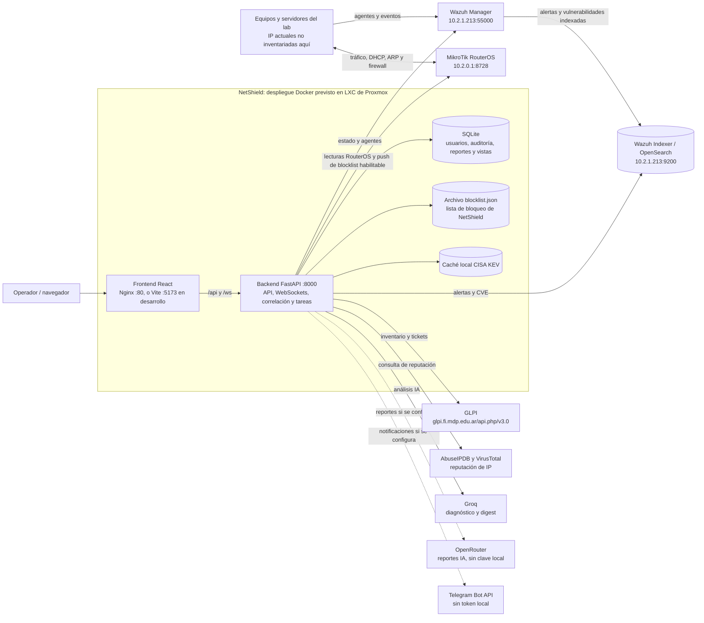

# NetShield en el lab: componentes, ubicación y flujo

**Relevamiento del repositorio: 11 de noviembre de 2026.** Este esquema describe el código y la configuración local disponibles. No confirma que los equipos o servicios del lab estén encendidos ni que el despliegue de Proxmox esté activo. El workflow de despliegue crea su `.env` desde un secreto de GitHub, que podría diferir del `.env` local.

## Mapa general

Las flechas continuas representan integraciones implementadas y configuradas como destino; **no son pruebas de conectividad**. Las punteadas requieren configuración adicional. La IP del LXC donde se ejecutaría NetShield no aparece en el repositorio.

## Dónde vive cada componente

| Componente | Tipo y ubicación según código/configuración | Qué aporta | Estado que puede afirmarse |
|---|---|---|---|
| NetShield frontend | Código en `frontend/`; imagen de Nginx, puerto 80 en perfil `prod`; Vite, puerto 5173 en `dev`. | Panel, login, vistas de red, firewall, Wazuh, inventario, reportes y digest. | Implementado. Despliegue en vivo no comprobado. |
| NetShield backend | Código en `backend/`; contenedor FastAPI/Uvicorn, puerto 8000. El workflow propone desplegarlo en un LXC de Proxmox mediante runner propio. | API, WebSockets, unión de fuentes, acciones, tareas programadas. | Implementado. Host/IP real no documentado. |
| SQLite | Base de la aplicación dentro del backend. En Docker: volumen `netshield-db` montado en `/app/data/db`, archivo `netshield.db`. En ejecución local desde `backend/`: `backend/netshield.db`. | Usuarios, auditoría, vistas, reportes, digest, diagnósticos y vínculos de tickets. | Configurado como base actual; no hay PostgreSQL desplegado en Compose. |
| Lista de bloqueo NetShield | JSON local del proceso backend: `BLOCKLIST_PATH` o, por defecto, `~/NetShield/blocklist.json`. | Fuente de IP/redes propuestas para bloqueo; exporta texto/JSON y puede hacer push al MikroTik. | Implementada. El Compose actual no monta un volumen para este archivo. |
| MikroTik RouterOS | Equipo externo en `10.2.0.1:8728`, según `backend/.env` local. | Red real: interfaces, tráfico, conexiones, ARP, DHCP, VLAN, firewall y reglas. | Destino configurado; no se verificó conexión. La API se usa principalmente para lectura. |
| Wazuh Manager | Equipo externo en `10.2.1.213:55000`, según `backend/.env`. | Estado y administración de agentes, respuesta activa. | Destino configurado; no se verificó conexión. |
| Wazuh Indexer | OpenSearch externo en `https://10.2.1.213:9200`, según `backend/.env`. | Alertas reales y vulnerabilidades de los agentes; alimenta digest, MITRE y diagnóstico. | Destino configurado; no se verificó conexión. No confundir con la API del Manager. |
| Agentes Wazuh | Instalados en los hosts monitoreados del lab. | Envían eventos y estado a Wazuh. | La implementación los consulta, pero las IP de agentes vigentes no están documentadas. |
| GLPI | Servicio externo en `https://glpi.fi.mdp.edu.ar/api.php`, API v3.0 OAuth2. | Inventario, activos, usuarios y tickets. El collector de NetShield actualiza su caché cada 5 minutos. | Destino y credenciales presentes en la configuración local; no se verificó conexión. La API antigua se usa sólo si hay tokens para datos de IP/adjuntos. |
| AbuseIPDB / VirusTotal | Servicios externos en Internet. | Reputación y contexto de IPs, consultados desde NetShield. | Claves presentes localmente; no se verificaron respuestas. |
| Groq | Servicio externo en Internet. | Análisis de diagnóstico IA y resumen del digest; el puntaje básico del digest se calcula localmente. | Clave presente localmente; no se verificaron respuestas. |
| CISA KEV | Feed público externo y caché en `backend/data/cisa_kev.json`. | Cruza CVE de Wazuh con vulnerabilidades explotadas conocidas. | Caché local presente; descarga en vivo no comprobada. |
| OpenRouter | Servicio externo en Internet. | Generación de reportes con IA y respuestas a Telegram. | Código implementado; sin clave en la configuración local examinada. |
| Telegram | Bot API externa; scheduler y webhook en el backend. | Envío de alertas/reportes y recepción de consultas. | Código implementado; sin token local, por lo que el bot no puede conectarse con esta configuración. |
| GeoLite2 | Dos archivos `.mmdb` locales, previstos para el backend y un volumen `netshield-geoip` en Docker. | País/ASN de IPs públicas. | No se encontraron las bases `.mmdb` en el checkout. Sin ellas el servicio devuelve datos vacíos para IPs públicas. |
| Portal público `/soporte` | Frontend y backend de NetShield, conectado a GLPI. | Alta/consulta de tickets sin login del dashboard. | Implementado, pero deshabilitado por defecto (`PUBLIC_TICKETS_ENABLED=false`). |

## Flujos concretos

1. **Consulta del panel:** navegador → frontend → `/api` o `/ws` → backend. Nginx hace de proxy en producción; Vite hace de proxy en desarrollo.
2. **Red y activos:** backend lee conexiones, ARP, leases y reglas del MikroTik; el collector trae activos de GLPI. El panel de actividad intenta asociar una IP con un equipo usando IP/MAC de GLPI y, si no alcanza, datos de DHCP.
3. **Alertas:** agentes → Wazuh Manager → Wazuh Indexer → backend → panel. Las alertas y CVE se leen del Indexer (`:9200`); el estado de agentes se consulta al Manager (`:55000`).
4. **Digest y diagnóstico:** backend combina alertas/CVE de Wazuh con el catálogo CISA KEV y contexto del MikroTik cuando hay coincidencia de IP. Groq redacta el análisis si responde; el resultado y su historial se guardan en SQLite.
5. **Bloqueo:** una acción del panel agrega IP/red a `blocklist.json`. Se publica para descarga o se envía a RouterOS mediante push manual/intervalo **sólo si** se habilita la escritura de API. La variable local no habilita esa escritura y el valor por defecto es `false`; el propio archivo puede guardar un override cuyo estado en el LXC se desconoce.
6. **Inventario y soporte:** el backend consulta GLPI por OAuth2, mantiene una lista ligera de activos en memoria y busca el detalle bajo demanda. El portal público de tickets requiere activación explícita.

## Componentes mencionados en documentación anterior

- **CrowdSec:** hay router y servicio en el árbol de código, pero `backend/main.py` no registra su router y `frontend/src/App.tsx` no muestra sus páginas. La configuración local tampoco define clave de CrowdSec. No debe dibujarse como integración operativa actual.
- **Suricata:** la documentación vieja describe un sensor y un flujo `eve.json → Wazuh`, pero en este checkout falta `backend/services/suricata_service.py` y no se registra un router Suricata. Queda un WebSocket y varios widgets que lo referencian: ese circuito está incompleto en el código actual. No hay IP actual confirmada del sensor.
- **Redis:** figura como posibilidad en la configuración, pero Compose no lo levanta ni la aplicación lo usa como base/cache principal.
- **GeoLite2 en Docker:** Compose monta las bases en `/app/data/geoip`, mientras que el valor por defecto de `backend/config.py` apunta a `backend/data/geoip/...`. Hace falta ajustar las rutas en el entorno desplegado para que el volumen se lea correctamente.
- **IPs antiguas:** `192.168.100.118`, `100.90.106.121`, `192.168.88.50` y `glpi.facultad.local` aparecen en documentos previos. Para este mapa se priorizaron los destinos de `backend/.env` local, sin asumir que estén accesibles hoy.

## Fuentes del relevamiento

- Configuración efectiva local: `backend/.env` (sólo se tomaron destinos y presencia de claves; no se copiaron secretos) y `backend/config.py`.
- Integraciones y tareas: `backend/main.py`, `backend/services/`, `backend/routers/` y `frontend/src/App.tsx`.
- Despliegue previsto: `docker-compose.yml`, `Dockerfile.backend`, `Dockerfile.frontend`, `nginx.conf` y `.github/workflows/deploy.yml`.
